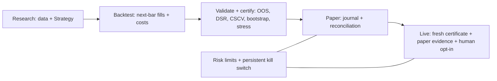

# financial-agent

A Python platform for systematic ETF research, cost-aware portfolio backtesting,
statistical certification, paper trading and explicitly gated Alpaca execution.
It also retains an equity-research harness and separate RL/deep-learning research
stacks. Version **1.0.0 is beta**: live performance is unproven, and neither a
historical gate pass nor paper results guarantee profit.



## Five-minute offline quickstart

Install [uv](https://docs.astral.sh/uv/getting-started/installation/); Python 3.12
is selected by `.python-version`. From the repository root:

```sh
uv sync --locked
uv run fa-quant demo
uv run fa-quant --help
```

The demo uses seeded synthetic data with a planted trend. It runs backtest,
validation/certificate creation, 25 local paper sessions and status without
network access after dependencies are installed. Its printed numbers demonstrate
software behavior, not market performance. To keep the artifacts, use a fresh
state directory:

```sh
uv run fa-quant demo --sessions 25 --state-dir /tmp/fa-quant-demo-release
```

Core dependencies include NumPy `<2`, pandas `>=2,<3`, yfinance, Gymnasium and
requests. Default development tools are installed by `uv sync`; optional `rl`,
`dl`, `notebooks` and `research` extras add the heavier research stacks. Full
release verification uses `uv sync --locked --all-extras`.

## Real-data research

The example uses SPY, QQQ, IWM, EFA, EEM, TLT, IEF, LQD, GLD, DBC and VNQ,
weekly next-open fills, whole shares and a 2% cash buffer. Downloads are cached
under gitignored `var/`. Use the latest completed session as the inclusive end:

```sh
uv run fa-quant backtest --config examples/quant/paper.toml --end 2026-10-12 --json
uv run fa-quant validate --config examples/quant/paper.toml --end 2026-10-12 --json
uv run fa-quant certify --config examples/quant/paper.toml --end 2026-10-12 \
  --output var/quant-paper/certificate.json
```

`validate`/`certify` return 2 when any gate fails; failed certificates can be saved
but cannot authorize live trading. With `--config`, settings come from the TOML;
standalone strategy/provider/start flags do not override it. See
[strategy research](docs/quant/strategy-research.md) for grids and interpretation.

The [committed real-data evidence](reports/quant/2026-10-default-strategy-evidence.md)
uses the earliest common ETF date, **2006-02-06 through 2026-10-12**, unchanged
default costs and the disclosed four-variant trend grid. All four full-period
default comparisons are shown here:

| Strategy | CAGR | Net Sharpe | Max drawdown | Turnover/year |
|---|---:|---:|---:|---:|
| Trend vol target | 5.625% | 0.740 | 16.533% | 14.375× |
| Dual momentum | 11.100% | 0.754 | 26.397% | 10.550× |
| SPY buy-and-hold | 11.122% | 0.652 | 54.299% | 0.048× |
| 60/40 SPY/IEF | 8.212% | 0.785 | 31.979% | 0.206× |

Trend passes all eight historical checks: OOS Sharpe 0.729, DSR 0.996, OOS
maximum drawdown 17.114%. PBO 0.650 warns that in-sample parameter selection adds
no reliable value. Single-default dual momentum and 60/40 also pass all eight
statistical checks; SPY fails the OOS drawdown limit. For a single pre-registered
variant, CSCV computes absolute OOS loss frequency; PBO and degradation slope
are not applicable. Warmup/OOS windows differ; read the report for dates, exact
checks, costs, bootstrap intervals, stress results and data caveats. No parameters
or thresholds were tuned to pass. Statistical passes do not override execution
limits: default dual momentum's three slots allocate 33.3% each versus the 30%
per-name cap, and concentrated SPY/60-40 benchmarks also exceed runtime caps.

The dated equity `research_forecast` strategy also [fails its real-ledger gate](reports/quant/research-forecast-validation.md):
there is too little history to support promotion. This is the retained result
for the LLM research signal, not an implied trading edge.

## Paper trading and live gate

Load Alpaca **paper** keys into the process environment as `APCA_API_KEY_ID` and
`APCA_API_SECRET_KEY`; keep them out of TOML, git and command history. With keys
loaded, preview and run before the opening auction (around 08:45 New York time):

```sh
uv run fa-quant run --config examples/quant/paper.toml --dry-run
uv run fa-quant run --config examples/quant/paper.toml
uv run fa-quant status --config examples/quant/paper.toml
```

The release verifies execution through local paper and fake Alpaca transports;
a real credentialed paper run is still an owner step. A dry run suppresses new
orders but journals observations and can synchronize earlier fills.

Live needs `mode = "live"`, `FA_QUANT_ALLOW_LIVE=1`, a passing certificate no older
than 90 days matching the exact strategy/params, at least 20 distinct clean
Alpaca-paper sessions, no recent risk halts/reconciliation breaks, and observed
paper slippage within twice modeled allowance. Runtime risk limits cannot be
loosened by config. MCP exposes research and paper previews only. Read
[safety and go-live steps](docs/quant/safety.md) before changing mode, and
[operations](docs/quant/operations.md) for scheduling, kill/unkill and incidents.
Kill stops new submissions; it does not cancel orders or liquidate positions.

## Research harness, equity workflow and RL

The [native ticker workflow](docs/research/README.md) combines sourced evidence,
Decimal arithmetic, optional earnings/DCF/comps models and structural audits;
[retained research](docs/research/index.md) remains provisional. The
[daily equity workflow](agents/equity/daily_investment_system/main.md) produces
dated source/prediction packages. The harness provides deterministic report
checks and ledger audits, not autonomous completion of every prompt stage:

```sh
uv run python -m financial_agent.harness --help
uv run python -m financial_agent.harness audit --output-dir agents/equity/output
```

Generic RL supplies tabular Q-learning, GridWorld, Gymnasium wrappers and bounded
training/evaluation loops. [Examples](example/rl/) demonstrate learning APIs;
[notebooks](notebooks/README.md) retain historical experiment outputs. Install
`--extra rl`, `--extra dl` or `--extra notebooks` as needed. The FinRL-derived
`trading/` and TensorFlow `dl/` stacks are experimental; they do not feed capital
unless adapted to `Strategy` and passed through the same gates. The historical
autotrain entrypoint has unresolved signature/name issues and is not turnkey.

## Repository map

| Path | Purpose |
|---|---|
| [src/financial_agent/quant](src/financial_agent/quant/) | Data, strategies, backtest, validation, risk, execution, runner and CLI/MCP |
| [docs/quant](docs/quant/) | [Architecture](docs/quant/architecture.md), safety, operations, strategy guide |
| [examples/quant](examples/quant/) / [deploy/quant](deploy/quant/) | Paper TOML and cron/launchd/systemd templates |
| [reports/quant](reports/quant/) | Computed default and research-forecast evidence |
| [tests/quant](tests/quant/) | Deterministic offline regression coverage |
| [src/financial_agent/harness](src/financial_agent/harness/) | Equity schemas, gates, kernels and policy |
| [agents/equity](agents/equity/) / [skills](skills/) | Daily/native equity workflows and Turtle research |
| [src/financial_agent/rl](src/financial_agent/rl/) / [example/rl](example/rl/) | Generic RL APIs and examples |
| [src/financial_agent/trading](src/financial_agent/trading/) / [src/financial_agent/dl](src/financial_agent/dl/) | Financial RL and prediction research |
| [notebooks](notebooks/) / [archive](archive/) | Saved research outputs; avoid incidental reruns |

## Limitations

Yahoo's retrospectively adjusted OHLCV can change and is not raw auction
execution data. The fixed ETF universe retains selection bias. Simulations omit
taxes, cash interest, capacity/market impact and exact live corporate-action
accounting. Statistics measure this historical sample, not future profitability.
The scheduled runner does not continuously monitor intraday loss or guarantee
fills; reference-price limits do not eliminate gap risk. State/journal hashes
are integrity checks, not signatures. The POSIX runner targets macOS/Linux.

## License

[MIT](LICENSE). Software is provided as is, without warranty.
