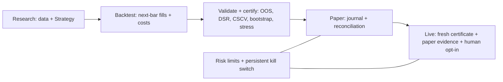

# financial-agent

[](https://github.com/BichengWang/financial-agent/actions/workflows/python-quality.yml)
[](https://pypi.org/project/fa-quant/)
[](https://www.python.org/)
[](https://bichengwang.github.io/financial-agent/)
[](LICENSE)

A Python platform for systematic ETF trading that has to earn its way to capital:
cost-aware backtests, a statistical promotion gate, journaled paper trading and
explicitly gated Alpaca and IBKR execution. It also holds an equity-research
harness and separate RL/deep-learning research stacks. The platform is **beta**:
live performance is unproven, and neither a historical pass nor paper results
guarantee profit.

**Docs:** <https://bichengwang.github.io/financial-agent/> has the quant guides,
evidence reports, equity research and changelog.



## Status (2026-10-28)

| Stage | State |
|---|---|
| Research gate | `trend_vol_target` passes all eight checks with its frozen identity `target_vol=0.12, max_weight=0.25` (data through 2026-10-27, DSR 0.994) |
| Paper evidence | Alpaca paper sessions scheduled weekdays before the open: first session 2026-10-29, first orders 2026-11-02; 0 of 20 clean sessions |
| Live | Not authorized. Earliest decision 2026-11-25, if no paper session halts |

The [paper-to-live plan](plan/2026-10-18-quant-paper-to-live.md) tracks the
remaining steps and decisions.

## Quickstart (offline, five minutes)

```sh
pip install fa-quant
fa-quant demo --sessions 25 --state-dir /tmp/fa-quant-demo
```

Or from a clone, with [uv](https://docs.astral.sh/uv/getting-started/installation/)
(Python 3.12 is pinned by `.python-version`):

```sh
uv sync --locked
uv run fa-quant demo
uv run fa-quant --help
```

The demo runs backtest, validation, certification, local paper sessions and
status on seeded synthetic data with a planted trend, without network access.
Its numbers show the software working, not market performance.

The PyPI distribution is `fa-quant`; it installs the `fa-quant` command and the
`financial_agent` import package. The unrelated `financial-agent` PyPI project is
not this one. Python 3.12 is tested; on 3.13+ the NumPy `<2` pin builds NumPy
from source. Examples, docs and evidence live in this repository. Optional `rl`,
`dl`, `notebooks` and `research` extras add the heavier research stacks;
`uv sync --locked --all-extras` installs everything.

## Real-data research

The example universe is SPY, QQQ, IWM, EFA, EEM, TLT, IEF, LQD, GLD, DBC and VNQ
with weekly next-open fills, whole shares, a 2% cash buffer and 2 bps half-spread
plus 3 bps slippage per side. Downloads are cached under gitignored `var/`. Use
the latest completed session as the inclusive end:

```sh
uv run fa-quant backtest --config examples/quant/paper.toml --end 2026-10-27 --json
uv run fa-quant validate --config examples/quant/paper.toml --end 2026-10-27 --json
uv run fa-quant certify --config examples/quant/paper.toml --end 2026-10-27 \
  --output var/quant-paper/certificate.json
```

`validate` and `certify` exit 2 when any check fails; a failed certificate can be
saved but never authorizes trading. With `--config`, all settings come from the
TOML. See [strategy research](docs/quant/strategy-research.md) for grids,
disclosed trials and how to read each statistic.

### Results

The [committed evidence](reports/quant/2026-10-default-strategy-evidence.md)
covers 2006-02-06 through 2026-10-12. Full-period backtests at default
parameters:

| Strategy | CAGR | Net Sharpe | Max drawdown | Turnover/year |
|---|---:|---:|---:|---:|
| Trend vol target | 5.625% | 0.740 | 16.533% | 14.375× |
| Dual momentum | 11.100% | 0.754 | 26.397% | 10.550× |
| SPY buy-and-hold | 11.122% | 0.652 | 54.299% | 0.048× |
| 60/40 SPY/IEF | 8.212% | 0.785 | 31.979% | 0.206× |

The trend strategy's promotion gate (walk-forward out-of-sample, 3,528 sessions):

| Protocol | Data | OOS Sharpe | DSR | OOS max drawdown | PBO | Verdict |
|---|---|---:|---:|---:|---:|---|
| Four-variant search | 2006-02-06 to 2026-10-12 | 0.729 | 0.996 | 17.1% | 0.650 | Pass; selects 0.12 / 0.25 |
| Frozen 0.12 / 0.25, four trials disclosed | 2006-03-01 to 2026-10-27 | 0.704 | 0.994 | 13.7% | n/a | Pass |

PBO 0.650 means picking the in-sample winner added no reliable value, and the
choice switched 6 times in 13 folds. So the selected identity is now frozen:
re-certification can no longer switch parameters and restart the paper clock.
DSR still deflates by all four variants tried. The frozen row's walk-forward
returns aren't out-of-sample for the choice of identity, which used the same
history; the freeze stabilizes the identity, it doesn't strengthen the
statistical case.

Dual momentum and 60/40 also pass all eight checks as single pre-registered
variants; SPY fails the 25% OOS drawdown limit. Statistical passes don't override
execution limits: dual momentum's three 33.3% slots and the concentrated
benchmarks exceed the 30% per-name cap. The equity `research_forecast` signal
[fails its real-ledger gate](reports/quant/research-forecast-validation.md) for
lack of history. No parameter or threshold was tuned to pass.

## Paper trading

Put Alpaca **paper** keys in the environment as `APCA_API_KEY_ID` and
`APCA_API_SECRET_KEY`, never in TOML, git or shell history. Preview, run and
inspect before the opening auction (orders must go out before 09:25 New York
time):

```sh
uv run fa-quant run --config examples/quant/paper.toml --dry-run
uv run fa-quant run --config examples/quant/paper.toml
uv run fa-quant status --config examples/quant/paper.toml
```

For unattended runs, schedule
[`deploy/quant/run-session.py`](deploy/quant/run-session.py) with the launchd,
cron or systemd templates beside it. It loads keys from a `chmod 600` env file,
passes the exit code through and posts a sanitized alert to
`FA_QUANT_ALERT_WEBHOOK` when a session halts. `status` reports live readiness:
clean sessions, halts, slippage against the allowance and certificate age. See
the [daily schedule](docs/quant/operations.md#daily-schedule).

IBKR uses the locally running Client Portal Gateway with a daily browser login.
Copy [ibkr-paper.toml](examples/quant/ibkr-paper.toml), set your USD paper account
ID and gateway port, and follow the
[gateway setup](docs/quant/operations.md#ibkr-client-portal-gateway). TLS
verification can be disabled only on loopback, and order questions halt unless
their message IDs are explicitly allowed.

## Live gate

Every live session re-checks all of these:

- `mode = "live"` in a separate TOML and `FA_QUANT_ALLOW_LIVE=1` in the
  environment.
- A passing certificate at most 90 days old for exactly the configured strategy
  and parameters.
- At least 20 distinct clean paper sessions with the same broker and identity,
  with fills, no halts or reconciliation breaks in that window, and mean
  slippage within twice the modeled cost.

Configs can tighten runtime risk limits, never loosen them. The MCP server
exposes research and paper previews only and can't place orders. The kill switch
persists and blocks new submissions, but doesn't cancel orders or liquidate.
Read [safety and go-live steps](docs/quant/safety.md) before changing mode and
[operations](docs/quant/operations.md) for kill/unkill and incidents.

## Equity research and RL

The [native ticker workflow](docs/research/README.md) combines sourced evidence,
Decimal arithmetic, optional earnings/DCF/comps models and structural audits;
[retained research](docs/research/index.md) remains provisional. The
[daily equity workflow](agents/equity/daily_investment_system/main.md) produces
dated source/prediction packages. The harness provides deterministic report
checks and ledger audits:

```sh
uv run python -m financial_agent.harness --help
uv run python -m financial_agent.harness audit --output-dir agents/equity/output
```

Generic RL supplies tabular Q-learning, GridWorld, Gymnasium wrappers and bounded
training loops; [examples](example/rl/) show the APIs and
[notebooks](notebooks/README.md) keep historical outputs. The FinRL-derived
`trading/` and TensorFlow `dl/` stacks are experimental: nothing reaches capital
unless it implements `Strategy` and passes the same gates. The historical
autotrain entrypoint is not turnkey.

## Repository map

| Path | Purpose |
|---|---|
| [src/financial_agent/quant](src/financial_agent/quant/) | Data, strategies, backtest, validation, risk, execution, runner and CLI/MCP |
| [docs/quant](docs/quant/) | [Architecture](docs/quant/architecture.md), safety, operations, strategy guide |
| [examples/quant](examples/quant/) / [deploy/quant](deploy/quant/) | Paper configs, scheduler wrapper and launchd/cron/systemd templates |
| [reports/quant](reports/quant/) | Dated strategy and research-forecast evidence |
| [tests/quant](tests/quant/) | Deterministic offline regression tests |
| [plan](plan/) | Dated design plans and the paper-to-live roadmap |
| [src/financial_agent/harness](src/financial_agent/harness/) | Equity schemas, gates, kernels and policy |
| [agents/equity](agents/equity/) / [skills](skills/) | Daily/native equity workflows and agent skills, including quant research and paper operations |
| [src/financial_agent/rl](src/financial_agent/rl/) / [example/rl](example/rl/) | Generic RL APIs and examples |
| [src/financial_agent/trading](src/financial_agent/trading/) / [src/financial_agent/dl](src/financial_agent/dl/) | Experimental financial RL and prediction research |
| [notebooks](notebooks/) | Saved research outputs; avoid incidental reruns |

## Limitations

- Yahoo's adjusted OHLCV is revised retrospectively and isn't raw auction data;
  paper slippage is measured against those adjusted opens.
- The fixed ETF universe carries selection bias. Simulations omit taxes, cash
  interest, capacity, market impact and exact corporate-action accounting.
- Statistics describe this historical sample, not future profitability.
- The scheduled runner doesn't monitor intraday loss or guarantee fills;
  reference-price limits don't remove gap risk.
- State and journal hashes are integrity checks, not signatures. The runner
  targets macOS and Linux.

## Contributing and security

See [CONTRIBUTING.md](CONTRIBUTING.md) for setup, checks and pull request rules,
and the [code of conduct](CODE_OF_CONDUCT.md). Report vulnerabilities privately as
described in [SECURITY.md](SECURITY.md).

## License

[MIT](LICENSE). Software is provided as is, without warranty.
