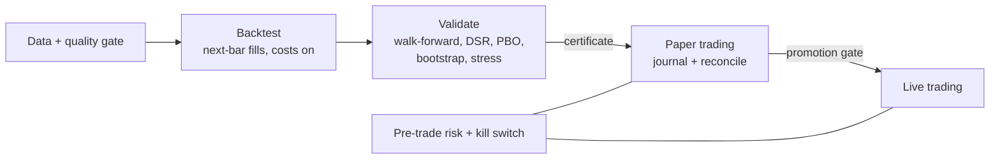

# Risk-Managed Systematic Trading Platform (`financial_agent.quant` v1)

**Date:** 2026-10-12 · **Status:** Delivered in v1.0.0 · **Target:**
release `v1.0.0`

## TL;DR

The repo researches markets but can't trade them: no portfolio backtester with
costs, no out-of-sample protocol, no order model, no broker, no risk controls
(see the gap map below). This plan adds one new package, `financial_agent.quant`,
that takes a strategy from research to capital through gates that can't be
skipped:



Positioning: **agents propose, statistics decide, code enforces.** LLM research
agents, RL policies, and hand-written rules are all just `Strategy` objects. They
reach money only after passing the same pre-registered statistical gate and a
paper-trading record. Deterministic risk limits sit between every decision and
the broker, and every action lands in a hash-chained journal.

## 1. What "make money" means here

No code can promise profit, and this plan doesn't claim to. It commits to the
things that decide whether a systematic strategy has a real edge or a
backtest artifact:

- **No lookahead by construction.** A strategy only sees data up to the decision
  close. Orders fill at the next session open (or close), never on the bar that
  produced the signal.
- **Costs are always on.** Commission, half-spread, and slippage are applied to
  every fill. Zero-cost runs need an explicit `CostModel.zero()`.
- **Overfitting is measured, not assumed away.** Walk-forward out-of-sample
  returns, the Deflated Sharpe Ratio, the Probability of Backtest Overfitting,
  bootstrap confidence intervals, and cost and delay stress tests.
- **Capital follows evidence.** Research → certified → paper → live. Live needs
  a fresh certificate, a clean paper record, and an explicit human opt-in.
- **Losses are bounded by code.** Position, exposure, turnover, order-size,
  daily-loss, and drawdown limits are checked before any order leaves the
  process. Breaches halt trading, fail closed, and journal the reason.

If the default strategy fails its gate on real data, the release says so. A
failed gate is a correct output.

### Why these default strategies

The v1 strategies come from the most replicated evidence in systematic
investing, not from fitting this repo's history:

| Strategy | Evidence |
|---|---|
| Time-series momentum / trend following | Moskowitz, Ooi & Pedersen, "Time Series Momentum" (JFE, 2012); Hurst, Ooi & Pedersen, "A Century of Evidence on Trend-Following Investing" (2017) |
| Volatility targeting | Moreira & Muir, "Volatility-Managed Portfolios" (JF, 2017); Harvey et al., "The Impact of Volatility Targeting" (2018) |
| Cross-sectional / dual momentum | Jegadeesh & Titman (JF, 1993); Asness, Moskowitz & Pedersen, "Value and Momentum Everywhere" (JF, 2013) |
| Overfitting controls | Bailey & López de Prado, "The Deflated Sharpe Ratio" (2014); Bailey, Borwein, López de Prado & Zhu, "The Probability of Backtest Overfitting" (2017); Harvey, Liu & Zhu, "… and the Cross-Section of Expected Returns" (RFS, 2016) |

## 2. Gap map (2026-10-12)

| Gap | Evidence |
|---|---|
| No execution layer | No broker, order, position, reconciliation, or scheduler code anywhere in `src/` |
| No portfolio backtester | RL envs fill at the same close they observe; `env_portfolio.py` has no costs; Turtle simulates one ticker at a time without costs |
| Lookahead in features | `trading/preprocessing/preprocessors.py` back-fills (`bfill`) and computes `pct_change` across stacked tickers |
| No out-of-sample protocol | Only `DRLEnsembleAgent.run_ensemble_strategy`, which tunes its turbulence threshold in-sample |
| Risk at report time only | `harness/kernels.py` risk functions are parametric and tied to the equity record schema; no pre-trade checks or kill switch |
| Trading code outside CI | `trading/`, `dl/`, and `turtle.py` are never tested, linted, or typed |
| Heavy, mixed dependencies | TensorFlow, Keras nightly, SB3, pyfolio, black, and mypy are runtime dependencies of every install |

The FinRL-derived `trading/` and `dl/` stacks stay as research code. They are
not deleted (committed notebooks import them) and not wired into live trading.
An RL policy reaches capital only by implementing `Strategy` and passing the gate.

## 3. Architecture

### 3.1 Package layout

```text
src/financial_agent/quant/
  __init__.py, __main__.py        CLI: python -m financial_agent.quant (fa-quant)
  quant_policy.toml               promotion thresholds + risk limits (defaults)
  data/        bars.py providers.py cache.py quality.py synthetic.py
  strategies/  base.py trend.py momentum.py benchmarks.py research.py registry.py
  backtest/    costs.py config.py engine.py result.py metrics.py
  portfolio.py                    target weights -> share deltas (shared by backtest and live)
  validation/  overfitting.py bootstrap.py walkforward.py stress.py gate.py certificate.py
  risk/        limits.py orders.py pretrade.py state.py killswitch.py
  execution/   broker.py paper.py alpaca.py reconcile.py journal.py
  runner/      config.py session.py promotion.py report.py
  mcp.py                          agent tools (research + paper preview only)
tests/quant/                      mirrors the package; network-free by default
```

### 3.2 Contracts

Every PR codes against these. Names are binding; internals are the implementer's
call. All public functions are typed, mypy-clean under the repo config, and
black/flake8 clean.

**Data (`quant.data`)**

```python
@dataclass(frozen=True)
class MarketData:
    open: pd.DataFrame; high: pd.DataFrame; low: pd.DataFrame
    close: pd.DataFrame; volume: pd.DataFrame
    # index: ascending, unique, tz-naive DatetimeIndex of sessions (shared)
    # columns: symbols (identical across fields)
    adjusted: bool          # split- and dividend-adjusted (total return) prices
    source: str
    symbols: tuple[str, ...]  # property
    sessions: pd.DatetimeIndex  # property
    def upto(self, asof: pd.Timestamp) -> "MarketData": ...      # inclusive
    def window(self, start: pd.Timestamp | None, end: pd.Timestamp | None) -> "MarketData": ...
    def fingerprint(self) -> str: ...   # sha256 of symbols, sessions, OHLCV values

class BarProvider(Protocol):
    def fetch(self, symbols: Sequence[str], start: dt.date, end: dt.date) -> MarketData: ...
# YahooProvider (yfinance, auto_adjust=True, batch download, retries)
# CsvProvider(directory)   one SYMBOL.csv per symbol: date,open,high,low,close,volume
# CachedProvider(inner, cache_dir)   incremental refresh, metadata (source, retrieved_at)
def check_quality(data, *, expected_last_session: dt.date | None = None, ...) -> QualityReport
#   QualityReport.ok, .issues[QualityIssue(code, symbol, session, detail, severity)]
def synthetic_market(symbols, sessions, *, seed, ...) -> MarketData   # deterministic
```

**Strategies (`quant.strategies`)**

```python
class Strategy(Protocol):
    name: str
    warmup: int                       # sessions needed before the first signal
    def params(self) -> dict[str, Any]: ...   # JSON-serializable; hashed into certificates
    def target_weights(self, data: MarketData) -> pd.Series: ...
    # Decision at the close of data.sessions[-1]. Index: data.symbols.
    # v1 is long-only and unlevered: every weight >= 0, sum <= 1; cash = 1 - sum.

def build_strategy(name: str, params: Mapping[str, Any] | None = None) -> Strategy
```

Built-ins: `trend_vol_target` (multi-lookback trend signal, inverse-vol sizing,
sample-covariance portfolio vol target, per-asset cap), `dual_momentum`
(top-k 12-1 momentum with an absolute filter into a defensive asset),
`buy_and_hold` (fixed weights, e.g. SPY), `sixty_forty` (SPY/IEF, rebalanced),
`research_forecast` (PR9).

**Backtest (`quant.backtest`, `quant.portfolio`)**

```python
@dataclass(frozen=True)
class CostModel:
    commission_per_share: float = 0.0; commission_min: float = 0.0
    commission_bps: float = 0.0; half_spread_bps: float = 2.0; slippage_bps: float = 3.0
    def fill_price(self, side: str, reference: float) -> float: ...
    def commission(self, shares: float, price: float) -> float: ...
    def scaled(self, factor: float) -> "CostModel": ...
    @classmethod
    def zero(cls) -> "CostModel": ...

@dataclass(frozen=True)
class BacktestConfig:
    initial_cash: float = 100_000.0
    cash_buffer: float = 0.0           # [0, 1); scale target gross to <= 1 - buffer
    rebalance: Literal["daily", "weekly", "monthly"] = "weekly"
    drift_threshold: float = 0.02     # min |target - actual| weight to trade a name
    execution: Literal["next_open", "next_close"] = "next_open"
    extra_delay: int = 0              # extra sessions between decision and fill (stress)
    fractional_shares: bool = False
    min_trade_notional: float = 0.0
    costs: CostModel = CostModel()
    start: pd.Timestamp | None = None  # optional earliest decision session

def rebalance_deltas(targets, positions, prices, nav, *, drift_threshold,
                     fractional, min_trade_notional) -> dict[str, float]   # share deltas
def run_backtest(strategy, data, config) -> BacktestResult
#   BacktestResult: equity, returns (net daily), weights, trades, costs, turnover,
#   strategy_name, params, data_fingerprint, config, active_start (first decision or None), skipped_trades; .summary() -> dict
#   summary performance/annual turnover uses sessions strictly after active_start
def performance_summary(returns, *, benchmark=None, periods_per_year=252) -> dict[str, float]
#   total_return, cagr, ann_vol, sharpe, sortino, max_drawdown, calmar, hit_rate,
#   skew, kurtosis, var95, cvar95 (historical), beta/alpha vs benchmark when given
```

Backtest and live planning proportionally scale targets only when gross exceeds
`1 - cash_buffer`. A live config must set `cash_buffer > min_cash_pct`; the
runner enforces this reserve for execution costs. The reserve applies at
decision prices; gaps and subsequent price moves can consume it.

The engine calls `strategy.target_weights(data.upto(decision_session))` and never
passes later rows. Signals are computed on the rebalance calendar; fills apply
`CostModel` at the next open (or close) after `extra_delay` sessions. Cash earns
0 (a conservative, documented choice; `rf = 0` in Sharpe).

**Validation (`quant.validation`)**

```python
def probabilistic_sharpe_ratio(returns, sr_benchmark: float = 0.0) -> float
def deflated_sharpe_ratio(returns, *, n_trials: int, trials_sharpe_variance: float) -> float
def pbo_cscv(variant_returns: pd.DataFrame, n_splits: int = 16) -> PBOResult
def block_bootstrap_ci(returns, statistic, *, n: int, block: int, seed: int, alpha: float) -> tuple[float, float]
def walk_forward(factory, grid, data, config, *, train_sessions, test_sessions,
                 embargo_sessions) -> WalkForwardResult
#   stitched OOS returns, per-fold chosen params, full-period returns per variant
def evaluate_promotion(name, grid, data, config, policy) -> PromotionReport
#   PromotionReport.passed, .checks[Check(name, value, threshold, passed, detail)]
def write_certificate(report, path) -> Path; def verify_certificate(path, *, max_age_days, ...) -> Certificate
#   certificate hash covers strategy name + params, data fingerprint, policy hash, package version
```

Thresholds live in `quant_policy.toml [promotion]`, mirroring the
`harness/equity_policy.toml` policy-as-data pattern. Defaults: ≥ 2,520 OOS sessions,
OOS net Sharpe ≥ 0.5, DSR ≥ 0.95, OOS max drawdown ≤ 25%, Sharpe ≥ 0.3
at 2× costs and with one extra session of delay, bootstrap 5th-percentile Sharpe > 0.
PBO is reported as a diagnostic; the blocking selection check is CSCV probability
of out-of-sample loss ≤ 0.10. Relative ranks can reverse among near-identical
profitable variants, so the gate measures absolute loss rather than rank reversal.

**Risk (`quant.risk`)**

```python
@dataclass(frozen=True)
class RiskLimits:  # quant_policy.toml [risk]; a run config may tighten, never loosen
    max_weight: float = 0.30; max_gross: float = 1.0; allow_short: bool = False
    max_order_notional_pct: float = 0.35; max_turnover_pct: float = 1.0
    max_daily_loss_pct: float = 0.03; max_drawdown_pct: float = 0.20
    min_cash_pct: float = 0.01; price_band_pct: float = 0.05; max_orders: int = 50
    allowed_symbols: tuple[str, ...] = ()   # empty = the configured universe

Order(symbol, side, qty, order_type="market", time_in_force="opg", limit_price=None, *, client_order_id)
Position(symbol, qty, avg_price, market_price); AccountSnapshot(cash, equity, positions, as_of)
def plan_orders(targets, account, prices, *, session, strategy, config) -> list[Order]
#   wraps rebalance_deltas; sells before buys; deterministic client_order_id
#   = hash(strategy, session, symbol, side, qty)
def check_orders(orders, account, prices, limits, *, kill_switch) -> RiskDecision
#   RiskDecision.approved, .rejected[(order, reason)], .halt, .reasons
RiskState(high_water_mark, day_start_equity, session)  # KillSwitch alone owns killed status
def update_risk_state(state, account, limits, *, session) -> tuple[RiskState, list[str]]
KillSwitch(state_dir)   # KILL file or persisted breach; released only by an explicit operator command
```

**Execution (`quant.execution`)**

```python
class Broker(Protocol):
    name: str; is_live: bool
    def account(self) -> AccountSnapshot: ...
    def submit(self, order: Order) -> OrderAck: ...      # idempotent on client_order_id
    def lookup(self, client_order_id: str) -> OrderAck | None: ...
    def open_orders(self) -> list[OrderAck]: ...
    def cancel_all(self) -> int: ...
PaperBroker(state_path, costs, initial_cash)    # persisted; fills pending orders at the
                                                # next session's open from MarketData
AlpacaBroker(key_id, secret_key, *, session=None, live_authorization=None)
IBKRBroker(account_id, *, base_url="https://localhost:5000/v1/api", verify=True,
           session=None, live_authorization=None, conids=None,
           confirm_message_ids=(), timeout=10.0, max_retries=3)
#   paper endpoint by default; the live endpoint requires a LiveAuthorization
Journal(path)   # append-only JSONL, each event carries seq, ts, prev_hash, hash; verify()
def reconcile(expected: Mapping[str, float], account: AccountSnapshot) -> list[Break]
```

**Runner (`quant.runner`) and CLI**

```python
TradingConfig.load(path)   # TOML: strategy, universe, data, backtest, broker, mode, state_dir, risk overrides
def run_session(config, *, today, dry_run=False, now=None) -> SessionReport
#   status in {"TRADED", "NO_CHANGE", "NO_SESSION", "HALTED"}
#   now: submission clock returning aware datetimes (default: system clock)
def authorize_live(config, *, certificate, journal, environ) -> LiveAuthorization
def live_readiness(config, *, now) -> LiveReadiness
#   certificate + paper-evidence checks of authorize_live without the opt-in or a grant
```

`run_session` order, failing closed at each step:

1. Lock the state dir; stop if the kill switch is engaged.
2. Calendar: no session today → `NO_SESSION` (reuse `harness.market_calendar`).
3. Refresh data through the last completed session; a failed quality gate → `HALTED`.
4. Sync the broker (paper fills settle here), reconcile against the journal; a break → `HALTED`.
5. Update risk state; a drawdown or daily-loss breach engages the kill switch → `HALTED`.
6. Strategy targets from data ≤ the last close; plan orders; pre-trade check;
   any hard-limit breach → `HALTED` with nothing submitted.
7. Submit market-on-open orders with idempotent IDs (a rerun never duplicates);
   broker-backed adapters submit only on `today` before the packaged New York
   opening-auction cutoff, checked before intents and before each submission;
   journal every step; write `reports/<date>.json` and `.md` in the state dir.

CLI (`python -m financial_agent.quant`, console script `fa-quant`):
`data fetch|check`, `backtest`, `validate`, `certify`, `run`, `status`, `kill`,
`unkill`, `mcp`. The MCP server exposes research and paper-preview tools only; no
tool can submit an order, and live mode is reachable only from the CLI.

### 3.3 Safety model

| Layer | Rule |
|---|---|
| Default mode | `paper`. The packaged example config never points at a live endpoint |
| Live opt-in | `mode = "live"` in config **and** `FA_QUANT_ALLOW_LIVE=1` **and** `authorize_live` passing: certificate verified and ≤ 90 days old for the same strategy/params; ≥ 20 paper sessions; zero risk halts and reconciliation breaks in the last 20; realized paper slippage ≤ 2× modeled |
| Limits | `RiskLimits` from policy; run configs can only tighten them (enforced) |
| Fail closed | Stale or bad data, reconciliation break, limit breach, broken journal chain, invalid certificate → no orders, `HALTED`, non-zero exit |
| Kill switch | A file or a persisted breach; cleared only by `fa-quant unkill --reason ...`, which is journaled |
| Secrets | From the environment only (`APCA_API_KEY_ID`, `APCA_API_SECRET_KEY`); never written to journals or reports |
| Agents | MCP and skills get research and preview tools; order submission and live mode are CLI-only |

This supersedes principle 6 of `plan/2026-09-28-financial-harness-and-skills.md`
("the harness never places orders") for `quant` only. The harness stays
decision support, and order placement exists only in `quant.execution` behind
`run_session`.

### 3.4 Decisions taken (owner may override)

- **Brokers:** Alpaca REST v2 and IBKR Client Portal Web API through the locally
  run CP Gateway (REST; no TWS sockets or OAuth). Both use public `Broker.lookup`
  for submission/fill recovery. Live promotion requires same-broker paper evidence.
- **Universe:** liquid US-listed multi-asset ETFs with long histories (SPY, QQQ,
  IWM, EFA, EEM, TLT, IEF, LQD, GLD, DBC, VNQ). ETFs limit survivorship bias,
  which single-stock universes built from today's index lists don't.
- **v1 is long-only and unlevered**, with whole shares and market-on-open orders,
  matching the backtest's `next_open` fill.
- **No new heavy dependencies.** pandas/numpy (pins unchanged), the stdlib
  (`statistics.NormalDist`, `tomllib`, `hashlib`), and `requests` for the broker.

## 4. Delivery: 10 PRs

Each PR has one purpose, ships tests, and passes CI on its own. It is opened from
the latest `main` and merged before dependent work branches. PRs in the same wave
touch disjoint files and are developed in parallel; each rebases onto the latest
`main` before it opens.

| Step | PR | Branch | Wave | Depends on | Scope | Acceptance |
|---|---|---|---|---|---|---|
| 1 | [#91](https://github.com/BichengWang/financial-agent/pull/91) | `docs/trading-platform-plan` | 0 | — | this plan | merged |
| 2 | [#96](https://github.com/BichengWang/financial-agent/pull/96) | `chore/split-dependency-extras` | 1 | 1 | core deps vs `rl`/`dl`/`notebooks`/`dev` extras; CI installs the extras it needs | `uv sync --locked` (core) imports `financial_agent.harness`; full suite passes with all extras |
| 3 | [#92](https://github.com/BichengWang/financial-agent/pull/92) | `feat/quant-data` | 1 | 1 | `quant.data` + CI lint/type/test for `quant` | offline tests for slicing, fingerprint, CSV/cache round trip, quality issues, deterministic synthetic data |
| 4 | [#93](https://github.com/BichengWang/financial-agent/pull/93) | `feat/quant-backtest` | 2 | 3 | `quant.strategies` (built-ins except research), `quant.backtest`, `quant.portfolio` | lookahead test (a peeking strategy gains nothing), next-open fills, costs hand-computed, metrics vs hand-computed values |
| 5 | [#95](https://github.com/BichengWang/financial-agent/pull/95) | `feat/quant-validation` | 3 | 4 | `quant.validation`, `quant_policy.toml [promotion]` | PSR/DSR vs published worked examples, PBO high for noise and low for a planted edge, certificate tamper detection |
| 6 | [#94](https://github.com/BichengWang/financial-agent/pull/94) | `feat/quant-risk` | 3 | 4 | `quant.risk`, `quant_policy.toml [risk]` | every limit rejects at the boundary; tighten-only enforcement; kill switch persistence |
| 7 | [#98](https://github.com/BichengWang/financial-agent/pull/98) | `feat/quant-execution` | 4 | 6 | `quant.execution`, `requests` dependency | paper fills at next open with costs; idempotent resubmit; Alpaca via fake transport (paper default, live refused without authorization); journal tamper detection |
| 8 | [#99](https://github.com/BichengWang/financial-agent/pull/99) | `feat/quant-runner` | 5 | 5, 7 | `quant.runner`, CLI, MCP tools, example config, launchd/cron/GitHub Actions templates | offline multi-session paper run on synthetic data: TRADED, then NO_CHANGE on rerun, HALTED on injected bad data, kill switch, live refused until gates pass |
| 9 | [#97](https://github.com/BichengWang/financial-agent/pull/97) | `feat/quant-research-signal` | 3 | 4 | `research_forecast` strategy over `agents/equity/output/*/15_predictions.json`, point-in-time by package date | point-in-time test; validation report on the real ledger history, whatever the verdict |
| 10 | [#100](https://github.com/BichengWang/financial-agent/pull/100) | `docs/quant-release` | 6 | all | README, `docs/`, AGENTS.md, CHANGELOG, `1.0.0` metadata, release workflow, real-data evidence report | fresh-clone quickstart works; evidence report committed; tag `v1.0.0` |

## 5. Release criteria (v1.0.0)

- CI green, including black, flake8, mypy, and pytest over `quant`.
- An offline demo runs end to end on synthetic data: backtest → validate →
  certify → several paper sessions → status, with no network.
- A committed real-data evidence report for the default strategy and both
  benchmarks: costs on, walk-forward OOS, DSR, PBO, stress, bootstrap CI, and the
  gate verdict as it comes out.
- Docs: quickstart, architecture, safety and operations runbook, and a strategy
  research guide.
- The live path is verified with a fake broker transport. A real Alpaca paper
  smoke run needs the owner's paper keys and is a documented step.

## 6. Non-goals for v1

Intraday or high-frequency trading, options, shorting and leverage, crypto,
PyPI publication (name availability unchecked), and RL policies in the live path
unless they pass the gate.
