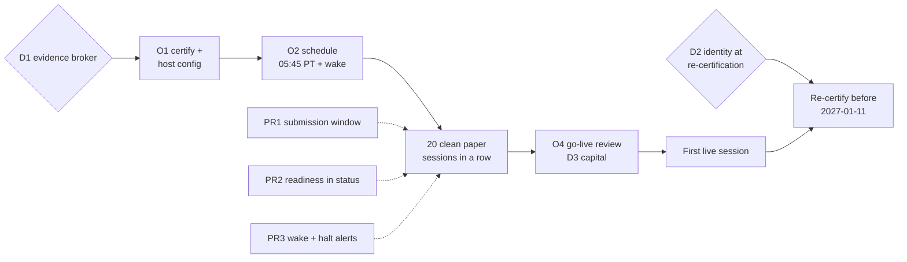

# Quant Next Steps: Paper Evidence to a Live Decision

**Date:** 2026-10-18 · **Status:** PR1 delivered in v1.1.1, PR2–PR3 in v1.2.0;
PR4 awaits D2; owner actions O1–O4 open · **Baseline:** v1.1.0 (`c54b9a3`);
`pytest tests agents/equity/daily_investment_system/tests` 690 passed, 1 skipped;
`fa-quant demo` runs end to end offline.

## TL;DR

v1.1.0 shipped every gate from research to live, but no real broker session has
run yet. Live trading needs **20 clean same-broker paper sessions in a row** with
the certified strategy identity. Nothing else gets capital closer, so the owner
should start that clock now. Three small PRs make the evidence reliable on the
real host. Without them, a late scheduler run or a halt nobody notices restarts
the clock.

- **Earliest live decision:** Fri 2026-11-13 if paper starts Mon 2026-10-19 with no
  halts, or 2026-11-20 if it starts 10-26. The 2026-10-13 certificate supports live
  authorization until **2027-01-11** (90 days).
- **Code:** PR1 refuses opening-auction submissions outside the pre-open window.
  PR2 shows live readiness in `fa-quant status`. PR3 adds scheduler wake-up and
  halt alerts. PR4 is conditional on decision D2.
- **Decisions:** D1 evidence broker, D2 identity at re-certification, D3 live
  capital, D4 the equity research track.

## 1. Where things stand

| Item | State | Evidence |
|---|---|---|
| Default certificate | `trend_vol_target` PASS, params `target_vol=0.12, max_weight=0.25` (lookbacks 21/63/126/252, halflife 42, cov 126), created 2026-10-13, hash `bd6e8ffc…` | `reports/quant/2026-10-default-strategy-evidence.json` → `strategies.trend_vol_target.certificate` |
| Parameter selection | PBO 0.650; the walk-forward choice changed 6 times in 13 annual folds; 7 of 14 folds picked `max_weight=0.35` | same JSON, `folds[*].chosen_params` |
| Example configs | Run factory defaults (`target_vol=0.10, max_weight=0.30`), which are not the certified identity. Their sessions never count toward live | `examples/quant/paper.toml`, `ibkr-paper.toml`; identity filter in `runner/promotion.py:102-113` |
| Real broker sessions | None. Live path verified only with fake transports | `docs/quant/safety.md:152-153` |
| Submission timing | The runner submits whenever it is invoked. `--today` defaults to the host-local `date.today()` | `runner/session.py:618-634`, `__main__.py:172-175` |
| Host scheduler | Host TZ is America/Los_Angeles, so the launchd template's 08:45 fires at 11:45 ET, after the OPG cutoff. launchd runs missed jobs on wake (`man launchd.plist`) | `deploy/quant/com.financial.quant-paper.plist`; cutoffs in `docs/quant/operations.md:15-19,80-82` |
| Readiness visibility | `status` shows NAV, drawdown, kill switch and the last 10 sessions. Readiness is only visible by calling `authorize_live`, which needs live mode, keys and `FA_QUANT_ALLOW_LIVE=1` | `runner/report.py:115-149` |
| Halt alerting | None. Exit code 2 and a log file only | `__main__.py:463` |
| `research_forecast` | 0 OOS sessions. The gate needs 1,260 training plus 2,520 OOS sessions (about 15 years of forecasts). The last committed daily package is dated 2026-09-03 | `reports/quant/research-forecast-validation.md` |
| CHANGELOG | No `[1.1.0]` link reference; `[Unreleased]` compares from `v1.0.1` | `CHANGELOG.md:78-80` |

## 2. Critical path

Dotted edges mean the PR protects the evidence but doesn't block the start.
Upgrading the package mid-paper doesn't reset evidence: sessions are filtered by
mode, broker, strategy and params, not by package version.

## 3. Owner actions (no code)

**O1. Certify and pin the identity.** Copy the D1 example config to a host-local
path outside git and keep `state_dir` absolute. Run
`uv run fa-quant certify --config <host.toml> --end 2026-10-16 --output <state_dir>/certificate.json`,
then paste the printed `[strategy]`/`[strategy.params]` into `<host.toml>`. Fresh
data may select a variant other than the 10-13 one. The new certificate defines
the identity either way. If it selects `max_weight=0.35`, take it to D2 before
starting: any target above the 30% runtime cap rejects the whole plan
(`docs/quant/safety.md:78-79,104-105`). Then run `fa-quant run --dry-run` and read
the planned weights.

**O2. Schedule on this Mac.** Set launchd to `Hour=5, Minute=45`; PT and ET change
DST on the same dates, so the 3-hour offset holds. Wake the machine first with
`sudo pmset repeat wakeorpoweron MTWRF 05:40:00`. Load credentials from a
protected wrapper, never from the plist or TOML. Until PR1 lands, a Mac that sleeps
through 05:45 runs the job late on wake, and Alpaca rejects OPG orders submitted
between 09:28 and 19:00 ET.

**O3. Daily check.** Read `<state_dir>/reports/<date>.md`. On `HALTED`, follow the
incident runbook (`docs/quant/operations.md`). A halt stays in the 20-session
window for the next 20 sessions (`max_halted_sessions = 0`), so each halt restarts
the clock.

**O4. Go-live review** at 20 clean sessions: `docs/quant/safety.md` "Go live step
by step" 4–6, plus D3. Use a separate live TOML and state dir, and a dedicated
account with no other holdings.

## 4. PRs

Each PR is opened from the latest `main` and merged before the next branches
(`AGENTS.md`). Each one updates `CHANGELOG.md [Unreleased]` and the affected
`docs/quant/` pages. If a PR changes a binding signature, it updates §3.2 of
`plan/2026-10-12-risk-managed-trading-platform.md` in the same PR.

| Step | Branch | Depends on | Scope | Acceptance |
|---|---|---|---|---|
| PR1 | `fix/quant-opg-submission-window` | — | Applies to broker-backed adapters (`alpaca`, `ibkr`) only; the local `PaperBroker` and the demo replay are unchanged. Add a packaged policy cutoff in America/New_York (`09:25`, 3 minutes before the 09:28 broker cutoffs). Approved orders are submitted only if the NY wall-clock date equals `today` and the time is before the cutoff. Check before journaling `submission_intent` and again before each `broker.submit`. Otherwise return `HALTED` with the observed time and cutoff. Sync and reconciliation still run first. `--today` defaults to the current NY date. Contract: `run_session(config, *, today, dry_run=False, now=None)`. Also fix the CHANGELOG link references | Injected clock: 08:45 ET → `TRADED`; 09:26 ET → `HALTED` with zero `submission_intent`/`submitted` events; a replayed `--today` against a broker adapter → `HALTED`; crossing the cutoff mid-plan stops before the next submit; a late run on an off-cadence day → `NO_CHANGE`; `fa-quant demo` output unchanged |
| PR2 | `feat/quant-live-readiness` | PR1 | Extract the certificate and paper-evidence evaluation from `authorize_live` into one `live_readiness(config, *, now) -> LiveReadiness`: clean sessions, halts and breaks in the window, fills, mean and per-fill slippage against the allowance, certificate age, verdict and identity match, and reasons. `authorize_live` adds only the environment/mode checks and the grant. `status_summary`/`render_status` show readiness for broker-backed paper configs, reading only the journal and certificate. Thresholds are unchanged | Existing promotion tests pass unchanged. On journal fixtures, `status` reports the same unmet reasons `authorize_live` would raise. `status` makes no broker call and grants nothing |
| PR3 | `chore/quant-scheduler-alerts` | PR1 | Add a `deploy/quant` wrapper that loads credentials from a `chmod 600` env file, runs `fa-quant run --json`, and on a non-zero exit posts status and sanitized reasons to `FA_QUANT_ALERT_WEBHOOK`. The launchd/cron/systemd templates call the wrapper. The launchd template gives a Pacific-host example and the `pmset` wake. Update the operations schedule section | A halted session on the fake transport posts exactly one alert carrying status and reasons and no credential values. Exit codes pass through. Templates reference the wrapper |
| PR4 | `feat/quant-disclosed-trials` | D2 = (b) | Certification carries disclosed prior trials (count and trial Sharpe variance) into DSR when the evaluated grid is smaller than what was tried (`validation/gate.py:211` uses `len(grid)` today). Freeze the single variant in the example configs and re-certify. Note the protocol change in the evidence report | DSR for a one-variant grid with disclosed trials of 4 equals the 4-trial computation from the 2026-10 evidence. A certificate without a disclosure is unchanged |

Release: PR1 ships as `1.1.1`; PR2 and PR3 ship together as `1.2.0`.

## 5. Decisions needed

**D1. Evidence broker.** Evidence doesn't transfer between brokers.

- *Alpaca paper (recommended):* API keys and unattended runs. This is the most
  likely way to get 20 clean sessions in a row.
- *IBKR paper:* the CP Gateway needs a browser login every day, before 05:45 PT on
  this host. A missed login is a broker error and therefore a halt. Choose this
  only if live will be on IBKR. It can run in parallel with Alpaca under its own
  state dir.

**D2. Identity at re-certification.** Every live session runs `authorize_live`,
which needs a certificate at most 90 days old with identical params. Selection is
close to noise (PBO 0.65, 6 switches in 13 folds), so a re-certification can switch
params. Live then stops until the new identity has 20 paper sessions.

- *(a) Status quo:* re-certify around day 45 (2026-11-27). If the identity changes,
  start paper for it right away: 29 sessions remain before 2027-01-11 for the 20
  needed, so any halt after the 9th session misses the deadline. Half of past
  selections (`max_weight=0.35`) can't run under the 30% cap.
- *(b) Freeze the current certified identity* as a single pre-registered variant
  for future certifications. All 4 tried variants stay disclosed in DSR (PR4).
  Recommended: it removes switches and infeasible selections, and changes no
  threshold. It is a protocol change and needs explicit owner approval. Not needed
  before the first live authorization.

**D3. Live capital and account.** The evidence is for $100k with whole shares.
Before live, run `fa-quant backtest` at the intended account size: whole-share
rounding grows as capital shrinks. Use a dedicated, otherwise empty account.

**D4. Equity research track.** Nothing has been committed since 2026-09-03. Harness
Phase 1 needs 10 consecutive gated runs, and 8 decisions in §6 of
`plan/2026-09-28-financial-harness-and-skills.md` are still open. Under the current
gate, `research_forecast` can't reach capital for about 15 years, and the gate
must not be relaxed to change that. Options: resume daily runs as decision support
and work Phase 1, or pause the track while quant paper evidence accumulates.

## 6. Risks

| Risk | Mitigation |
|---|---|
| A late or replayed run submits for the wrong auction, or a queued order creates an unreported fill and a reconciliation halt | PR1; O2 wake schedule |
| A halt nobody notices costs days of evidence | PR3 alerts; O3 daily check |
| Measured slippage compares raw fills with Yahoo *adjusted* opens (`session.py:191`). A dividend adjustment between the fill and its observation can inflate it [INFERENCE: depends on when Yahoo posts adjustments] | PR2 per-fill slippage; investigate outliers before O4. Never loosen `max_slippage_multiple` |
| A certified identity breaches the 30% runtime cap | O1 check; D2 |
| Gaps and outages: kill stops new submissions but doesn't cancel or liquidate (by design) | Incident runbook; broker-side actions by the operator |
| Smaller live account than the evidence assumed | D3 sized backtest |

## 7. Not now

- Dual momentum as a second sleeve. Default `top_k=3` puts 33.3% in a slot, above
  the 30% cap. It needs a new pre-registered variant, a separate account and state,
  and its own evidence.
- GitHub Actions paper workflow. It stays manual: it keeps state in an evictable
  cache and runs factory-default params, so its sessions don't count toward live.
- Intraday monitoring, stop orders, shorting, leverage, RL policies in the live
  path, PyPI publication, and any gate or threshold change.
