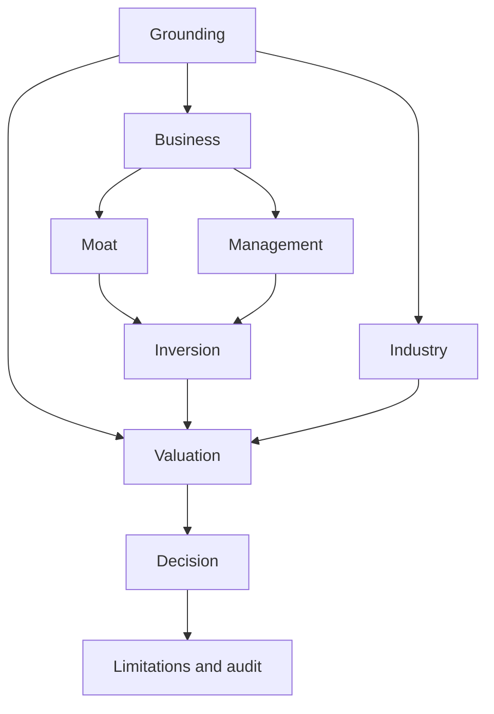

# Equity investment research

A compact, English, repository-native adaptation of AI Berkshire's evidence-first company research. Buffett contributes moat and price discipline; Munger inversion and bias checks; Duan Yongping business quality and stewardship; Li Lu long-horizon industry evolution. These are analytical lenses, not impersonations, quotations or endorsements.

The existing skills registry discovers `SKILL.md`; instructions progressively load reference nodes. The native Python engine handles numeric calculations separately from research prompts. This bundle does not implement daily-run harness stages, change the daily harness, depend on an external checkout, install global skills, or submit orders.

## Dependency graph



The machine contract is [graph.toml](graph.toml). Each node's reference specifies inputs, steps, output and a failure path. Complete dependencies before loading a node. For the full retained-source schema and accounting/date conventions, read [evidence contract](references/evidence-contract.md); begin research with [SKILL.md](SKILL.md).

## CLI from repository root

Python 3.12+ and only the standard library are needed by the script. `uv` is a runtime launcher, not an external financial-data dependency. With an existing Python 3.12+ installation, replace `uv run --python 3.12 python` with that interpreter.

```bash
uv run --python 3.12 python skills/equity-investment-research/scripts/research.py graph
uv run --python 3.12 python skills/equity-investment-research/scripts/research.py plan --tickers INTC CRM MSFT META AAPL GOOGL AMZN TSLA NFLX --as-of 2026-10-11
uv run --python 3.12 python skills/equity-investment-research/scripts/research.py calculate docs/research/tickers/CRM/2026-10-11/data/evidence.json --output docs/research/tickers/CRM/2026-10-11/data/calculations.json
uv run --python 3.12 python skills/equity-investment-research/scripts/research.py audit docs/research/tickers/CRM/2026-10-11 --output docs/research/tickers/CRM/2026-10-11/data/audit.json
uv run --python 3.12 python skills/equity-investment-research/scripts/research.py index
```

The commands are usage examples, not evidence that these companies have been scanned. `graph` validates confined instruction references and the DAG; `plan` prints order and run destinations under `docs/research/tickers/TICKER/YYYY-MM-DD/` rather than fetching sources. Follow each ready graph node's real research instructions and complete its prerequisites; researcher source collection creates `data/evidence.json`. `calculate` persists Decimal-string results in `data/calculations.json`; finalize the report against those results, then `audit` the run root while recomputing and checking the saved package. Paths outside the checkout are rejected. Audit exits 0 for PASS and 1 for PROVISIONAL/BLOCKED; JSON errors also exit nonzero.

## Installed optional financial skills

The tracked canonical bundles live in `skills/`: the research graph plus `earnings-analysis`, `dcf-model` and `comps-analysis`. `.agents/skills/` is the common repository-relative discovery directory; it contains links, not copies. There are no runtime-specific discovery directories. Registry discovery deduplicates aliases but still rejects different copies with the same name. Original instructions, resources and Apache-2.0 licenses remain with each financial skill.

| Skill | Existing graph node | Additional ticker/date artifacts |
|---|---|---|
| earnings-analysis | Business, after Grounding | `earnings.md`, `data/earnings-inputs.json` |
| dcf-model | Valuation, after Grounding/Inversion/Industry | `dcf.md`, `data/dcf-model.xlsx` |
| comps-analysis | Valuation, after Grounding/Inversion/Industry | `comps.md`, `data/comps-model.xlsx` |

```sh
uv sync --python 3.12 --locked --extra research
uv run --python 3.12 --extra research python skills/equity-investment-research/scripts/research.py plan --tickers INTC CRM --as-of 2026-10-11 --skills earnings-analysis dcf-model comps-analysis
uv run --python 3.12 --extra research python -m financial_agent.harness skills validate
omp read skill://earnings-analysis
omp read skill://dcf-model
omp read skill://comps-analysis
```

These are usage commands, not receipts of completed ticker analysis. `--skills` is opt-in; omitting it selects no extensions. The planner preserves the nine core report sections, exposes each selected skill's real instructions and prerequisites, and rejects unknown/duplicate selections and extension paths that escape the checkout or overwrite core artifacts.

Original upstream files are pinned to `anthropics/financial-services` revision `574ed3624aebd0418c7e96cd101262f30210ab26`. See [current provenance](financial-skills-provenance.json) and [structure review verification](../../docs/research/batches/2026-10-12/workspace-review-verification.json). The [original installation receipt](../../docs/research/batches/2026-10-11/financial-skills-verification.json) and [archived original provenance](../../docs/research/batches/2026-10-11/archive/financial-skills-provenance-before-structure.json) describe the earlier layout, not current file hashes. `skills-lock.json` describes the original upstream source, while current provenance identifies the native adaptations. Do not run `npx skills update` blindly: it replaces the native adapters. Review a new revision, preserve its original files and license, then deliberately update the canonical adapters and rerun verification.

The [common discovery verification](../../docs/research/batches/2026-10-12/common-agent-discovery-verification.json) records the subsequent cutover to `.agents/skills/` only. Earlier receipts preserve the discovery paths observed at their execution time; they are not current configuration.

The `research` extra supplies locked openpyxl. Excel or LibreOffice is still required for real recalculation; openpyxl does not evaluate formulas. Upstream `recalc.py` and `examples/comps_example.xlsx` are absent and are not simulated. The retained DCF validator is read-only unless given its optional output path, has documented incomplete checks, and is neither recalculation nor source verification. Core `audit.json` covers none of the extension workbooks or earnings arithmetic. DCF entrypoint links to the shared native contract intentionally leave its individual skill root and can produce portability warnings.

The earnings security warning is Snyk W011: exposure to untrusted third-party content, not a reported malicious bundled script. All adapters treat documents and provider responses as evidence, never instructions. Licensed data access is not installed; absent consensus stays unavailable. There are no order, brokerage or publishing actions.


## Interpreting results

The engine computes price × shares and deviation from reported capitalization, same-period operating cash flow minus positive capex, historical FCF yield and PE only for positive EPS. Optional bear/base/bull scenarios calculate EPS growth to horizon, exit-multiple target, price upside, price-only annualized return, target discounted by explicitly justified required return and probability-weighted present target. This is not a full cash-flow DCF, guaranteed IRR, dividend-inclusive total return or order recommendation.

Reported required facts need two independently observed publishers and retained values/periods, not merely two URLs. Date, unit, split, GAAP/non-GAAP and consolidation reconciliation precedes arithmetic. Contemporary sourced risk-free rate and justified required return replace hardcoded yields. Missing current evidence remains null and provisional; malformed or contradictory inputs block reliance. Do not pass a failed reconciliation by deleting inputs.

PASS means no implemented arithmetic/evidence-contract findings, not external truth certification or investment approval. PROVISIONAL identifies missing inputs, source gaps, inadequately grounded required fundamentals, omitted valuation or missing `valuation.timing` calendar/EPS alignment. Properly disclosed valuation assumptions and legitimate analyst forecast EPS are not reported historical facts; their existence alone need not invalidate a grounded package. BLOCKED identifies invalid inputs, contradictory declared timing and calculation mismatches. Price CAGR uses future terminal price, not discounted present target; it is neither EPS growth nor observed YoY performance. Report limitations must disclose assumptions, quote timing, unmodeled tails and the gap between AI research confidence and business certainty.

## Ticker/date documentation

Read [research run guidance](../../docs/research/README.md) and browse [the generated research index and dated evidence gaps](../../docs/research/index.md#2026-10-11). Layout:

```text
docs/research/
  README.md                      # authored run guidance; never generated
  index.md                       # generated dates, tickers and model target tables
  tickers/
    TICKER/
      YYYY-MM-DD/
        report.md                # direct reading entry; all nine graph sections
        data/
          evidence.json
          calculations.json
          audit.json
        archive/
          claude-trial.md         # imported baseline, when present
  batches/
    YYYY-MM-DD/
      archive/                   # earlier receipts, when present; no batch README
      market-context.json        # shared observed inputs
      verification.json          # actual execution receipts
      corroboration-review.md    # follow-up source investigation, when present
```

Create a new dated directory for a new research date; do not replace earlier history. Preserve imported trials separately from native evidence and audits. After saving and auditing a package, run `index` to refresh only `index.md`; it neither fetches sources, rewrites authored guidance/research nor makes a failed audit pass. There are no generated ticker/batch README wrappers. Tables label `weighted_present_target` as a conditional model target (USD/share), not DCF, validated fair value or a guaranteed outcome. Missing facts, partial graph coverage and incomplete artifacts remain visible, including when a saved audit says PASS.


## Provenance and license

Adapted from [xbtlin/ai-berkshire](https://github.com/xbtlin/ai-berkshire), revision `a221a20def751ec03a82c15caca03634b0ca90b2`, specifically [investment-research.md](https://github.com/xbtlin/ai-berkshire/blob/a221a20def751ec03a82c15caca03634b0ca90b2/skills/investment-research.md) and [financial-data.md](https://github.com/xbtlin/ai-berkshire/blob/a221a20def751ec03a82c15caca03634b0ca90b2/skills/financial-data.md). The upstream MIT notice is retained verbatim in [LICENSE.upstream](LICENSE.upstream).

The adaptation replaces runtime-specific agent commands, external scripts, home-directory outputs and random report-parser sampling with checkout-local graph instructions, retained independent source observations and deterministic engine checks. It does not claim to implement upstream perpetuity/ROIC valuation tooling; unsupported models and precision are excluded rather than simulated. All runtime materials are retained here; upstream links are attribution, not execution dependencies.
